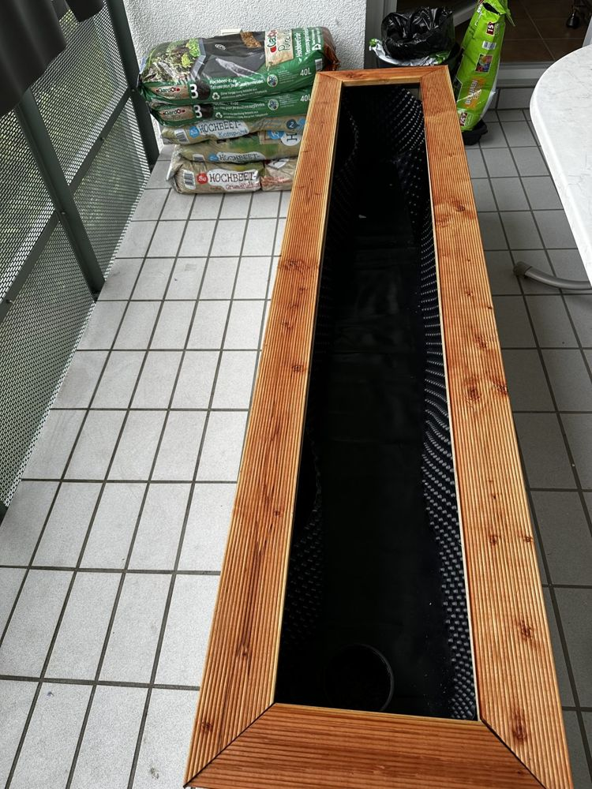
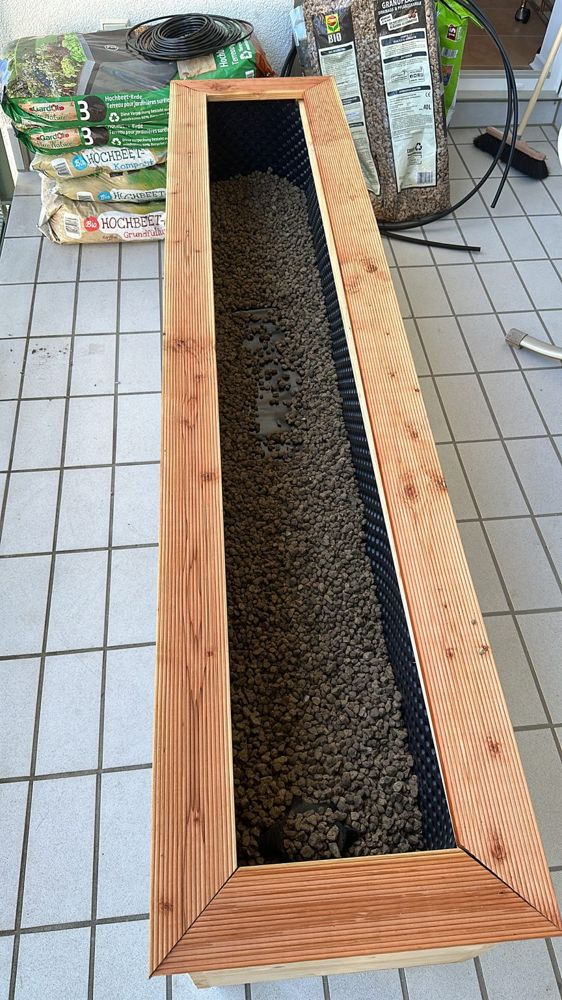
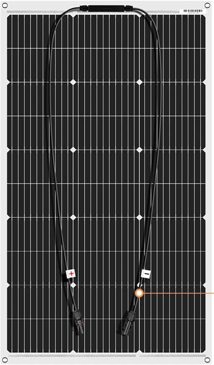
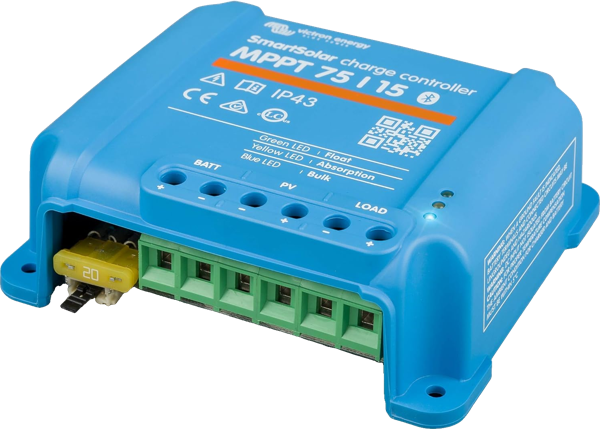
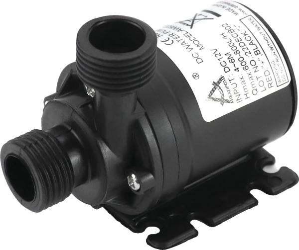
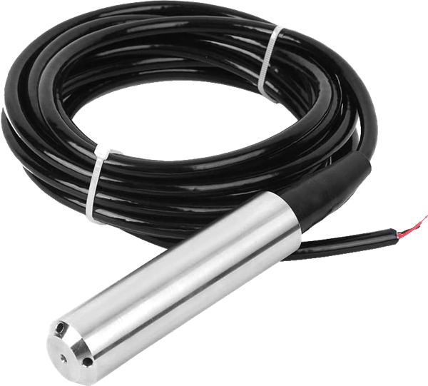

<div align="center">

# 🌱 Raised Bed Irrigation

**A self-built balcony raised bed that waters itself. Solar powered and controlled by Home Assistant.**

[](https://www.home-assistant.io/)
[](#hardware)
[](LICENSE)

[How it works](#how-it-works) •
[The bed](#the-bed) •
[Hardware](#hardware) •
[ESPHome](#esphome-devices) •
[Roadmap](#roadmap) •
[License](#license)

</div>

---

## How it works

Every day at 11 am Home Assistant checks how wet the soil is. If it is too dry the pump waters the bed for a few seconds through a drip line. The water comes from a small tank and the whole system runs on solar power. So the plants only get water when they need it and nobody has to water by hand, even during holidays.

### Solar power

A solar panel charges a battery through a Victron solar charge controller. Everything outside runs from this battery, there is no mains power. To save energy, the charge controller's **load output** is off most of the time. It only powers the soil moisture sensor and the pump while the daily check runs.

The **Victron-Controller** (an ESP32) sits next to the charge controller and talks to it over VE.Direct. It sends the solar data (battery, PV power, daily yield, errors) to Home Assistant and can switch the load output on and off. It also measures the water level in the small tank. The ESP32 has its own small backup cell: if that cell drops below 3.45 V it cuts its own solar supply and turns it on again above 3.95 V.

### How everything connects

```
 Solar panel ──► Victron charge controller ──► battery
                        │  VE.Direct
                        ▼
               Victron-Controller (ESP32) ──── tank water level, float switch
                        │  switches the load output on/off
                        ▼
                 load output (on only during the daily check)
                        │
        ┌───────────────┴───────────────┐
        ▼                               ▼
 Outside relay + soil              Water pump in tank
 moisture sensor                        │
        │                               ▼
        │                     Drip line ► one dripper per plant
        ▼
 ┌─────────────────────────────────────────────────────────┐
 │ Home Assistant: automation, dashboard and logbook       │
 └─────────────────────────────────────────────────────────┘
        ▲
        │
 Füllstandsanzeige (ESP8266) ── water level of the rainwater cistern
```

All devices talk to Home Assistant over Wi-Fi with the encrypted ESPHome API.

## The bed

| Build | Drainage |
|---|---|
|  |  |

- Wooden frame with a top edge made of grooved decking boards
- Dimpled membrane on the inside so the wet soil doesn't touch the wood
- Layers from bottom to top: expanded clay (drainage), base filling, compost and raised bed soil
- Drip line through the whole bed with one adjustable dripper per plant

## Hardware

| Part | What it does |
|---|---|
| 100 W flexible solar panel (97.4 × 56.5 cm, 1.05 kg) | Charges the battery |
| Victron Energy SmartSolar MPPT 75/15 (75 V, 15 A, 12/24 V, Bluetooth) | Solar charge controller. Its load output is switched on only while the automation runs. |
| Battery | Stores the solar energy, there is no mains power |
| Victron-Controller (ESP32) | Reads the charge controller over VE.Direct, switches the load output and measures the tank level ([config](esphome/victron-controller.yaml)) |
| Small water tank with QWORK® DC 12 V water pump (800 L/h) | Stores the water and pushes it into the drip line |
| Self-built soil moisture sensors | Measure how wet the soil is. Build and code: [dev-dany97/moistureSensor](https://github.com/dev-dany97/moistureSensor) |
| Relay ("outside relay") | Switches the pump and reports the soil moisture to Home Assistant |
| Drip line with drippers | Brings the water right to each plant |
| Füllstandsanzeige (ESP8266, ADS1115, TL-136 liquid level sensor, 12–32 V DC, 4–20 mA) | Measures the water level of the rainwater cistern in cm and litres ([config](esphome/fuellstandsanzeige.yaml)) |

| Solar panel | Charge controller | Water pump | Level sensor |
|---|---|---|---|
|  |  |  |  |
| 100 W, flexible | Victron SmartSolar MPPT 75/15 | QWORK® DC 12 V, 800 L/h | TL-136, 12–32 V DC, 4–20 mA |

## ESPHome devices

The ESPHome configs are in [`esphome/`](esphome):

| File | Device |
|---|---|
| [`victron-controller.yaml`](esphome/victron-controller.yaml) | ESP32 at the Victron charge controller: solar data, load output, tank level, backup cell |
| [`fuellstandsanzeige.yaml`](esphome/fuellstandsanzeige.yaml) | ESP8266 with a TL-136 pressure sensor for the cistern level, based on [this guide (German)](https://nachbelichtet.com/wasserstand-in-zisternen-mit-homeassistant-esphome-und-tl-136-drucksensor-messen) |

Passwords and keys are not in this repo. Copy [`secrets.example.yaml`](esphome/secrets.example.yaml) to `secrets.yaml`, fill in your own values and create a new API key for every device (`openssl rand -base64 32`). The VE.Direct part uses [syssi/esphome-victron-vedirect](https://github.com/syssi/esphome-victron-vedirect).

## Roadmap

- [x] Build guide for the soil moisture sensors ([moistureSensor](https://github.com/dev-dany97/moistureSensor))
- [ ] Dashboard cards for soil moisture and tank level
- [ ] Wiring diagram

## License

[MIT](LICENSE)
